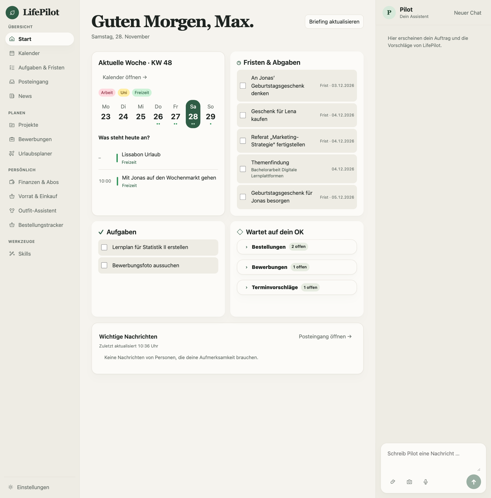
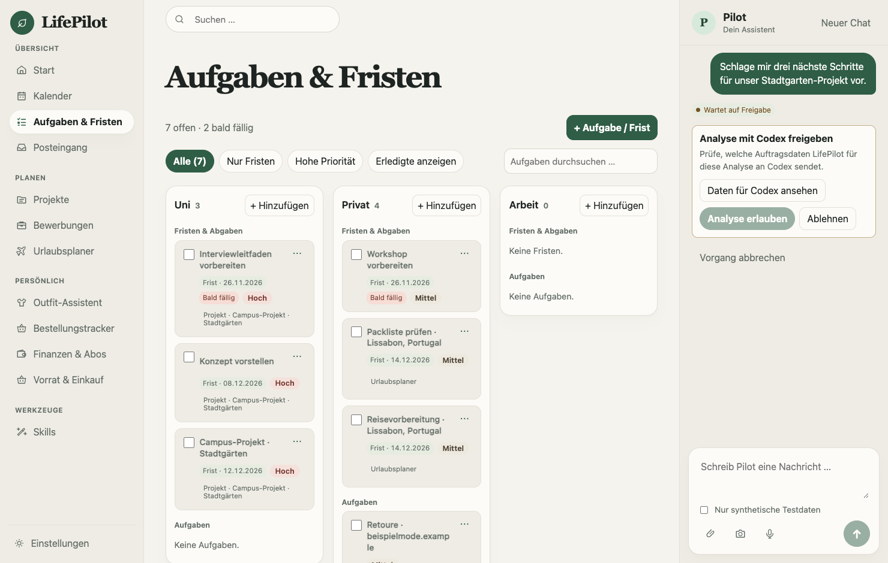
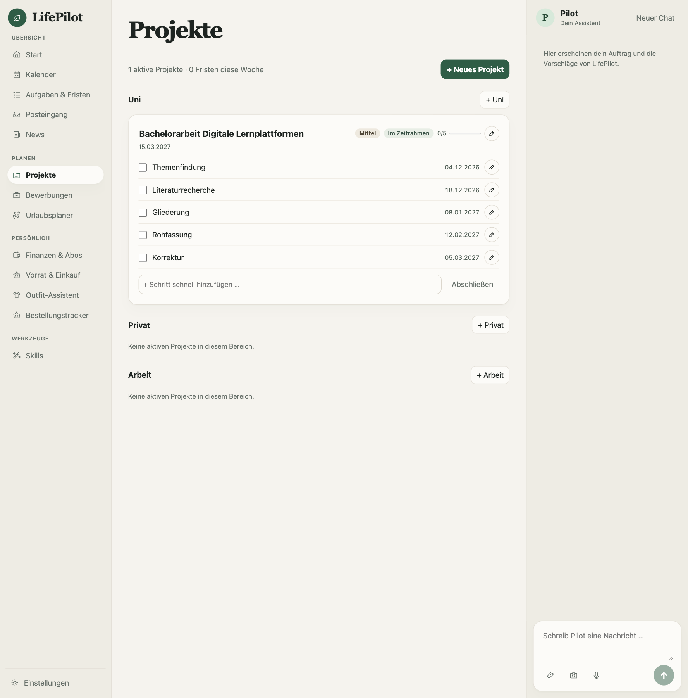
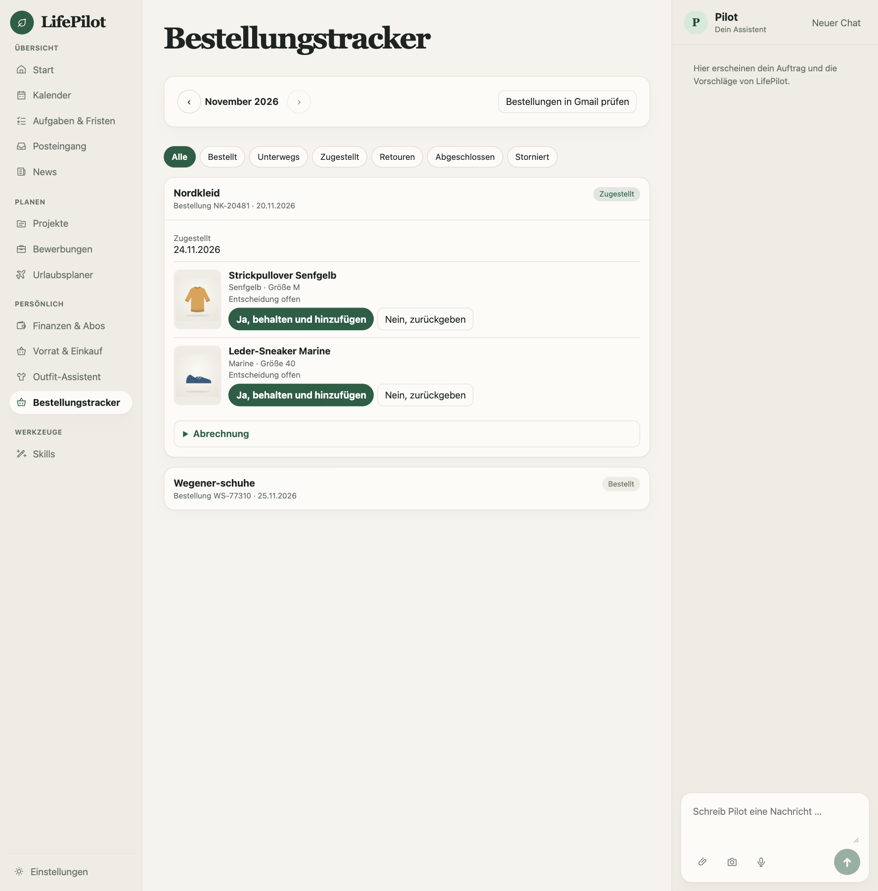
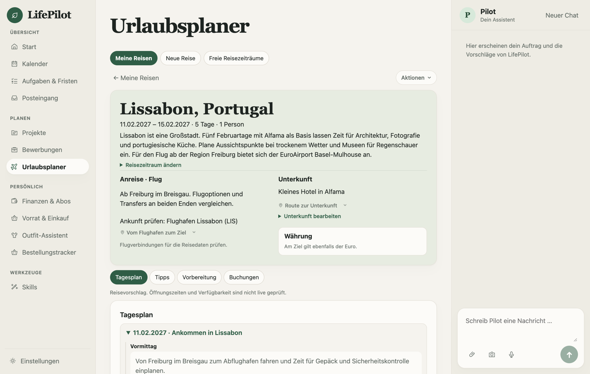

# LifePilot

LifePilot ist eine lokale macOS-App für persönliche Organisation. Startseite, Kalender, Aufgaben und Projekte greifen auf denselben SQLite-Datenbestand zu. Pilot hilft bei Rückfragen und bereitet Änderungsvorschläge vor. Der erste öffentliche Release **v1.0.0** enthält den Quellstand der Runtime **0.25.16**.

[Installation](#installation) · [Funktionen](#funktionen) · [Skills](docs/SKILLS.md) · [Änderungsverlauf](CHANGELOG.md) · [Roadmap](docs/ROADMAP.md)

## LifePilot im Einsatz

<table>
<tr>
<td width="50%" valign="top"><strong>Aufgaben und Fristen</strong> Private, berufliche und Uni-Aufgaben mit Priorität und Projektbezug. </td>
<td width="50%" valign="top"><strong>Projekte</strong> Phasen, Checkpoints und Abgaben in einer Projektkarte. </td>
</tr>
<tr>
<td width="50%" valign="top"><strong>Bestellungen</strong> Lieferungen verfolgen und je Artikel zwischen Behalten und Retoure entscheiden. </td>
<td width="50%" valign="top"><strong>Urlaubsplaner</strong> Reisezeitraum, Interessen und Ausschlüsse für eine Vorschau erfassen. </td>
</tr>
</table>

Alle Aufnahmen stammen aus dem isolierten Testprofil mit fiktiven Daten. Die Galerie zeigt außerdem Kalender, Posteingang, Finanzen, Kleiderschrank, Einkauf, Bewerbungen, Skills und Einstellungen. [Alle 13 Screenshots](docs/SCREENSHOTS.md)

## Installation

Vorausgesetzt sind macOS, Node.js 24 ab 24.13, npm, Git und die Xcode Command Line Tools. Dieser Stand wurde auf einem Mac mit Apple Silicon geprüft. Der Download enthält Quellcode, aus dem auch die nativen Helfer gebaut werden.

    git clone --branch v1.0.0 https://github.com/daniilobrant/lifepilot.git
    cd lifepilot
    xcode-select -p
    node --version
    npm ci
    npm run build
    npm test

Fehlen die Xcode Command Line Tools, installiere sie mit **xcode-select --install**. Node muss im PATH liegen.

### Einstieg im Testprofil

    ./bin/lifepilot --acceptance start
    ./bin/lifepilot --acceptance open

Öffne **Projekte**, lege ein fiktives Projekt mit Unterpunkten an und setze für einen Punkt eine Frist. Die Frist erscheint in **Aufgaben & Fristen**. Probiere danach eine erfundene Frage als Pilot-Entwurf aus. Die Galerie verwendet keinen Modellaufruf. Das Testprofil trennt die Daten lokal und sperrt externe Modellaufrufe und den Cloud-Reiseguide. Lokale Planung und gespeicherte Reisevorschauen bleiben verfügbar. Einzelne andere Funktionen können weiterhin externe Dienste nutzen. Verwende im Testprofil ausschließlich fiktive Daten.

    ./bin/lifepilot --acceptance stop

Für das Hauptprofil verwende dieselben Befehle ohne **--acceptance**. Die App öffnet sich lokal auf Port 45137, das Testprofil auf Port 45138. Der Checkout enthält keine Berechtigung für den persönlichen Chat und keine Kontodaten. Google und Codex sind optionale Integrationen. [Einrichtung, Datenspeicher und Grenzen](docs/SICHERHEIT.md)

## Funktionen

| Bereich | Was LifePilot unterstützt |
| --- | --- |
| Start und Pilot | Wochenübersicht, Aufgaben, Fristen, nächste Termine, wichtige Nachrichten, Rückfragen und Vorschläge zur Bestätigung |
| Kalender | Woche und Monat, Zeitfenster, Serientermine, Feiertage und gesonderte Bestätigung von Kollisionen |
| Aufgaben & Fristen | Aufgaben und Abgaben in Uni, Privat und Arbeit, mit Priorität, Datum und Projektbezug |
| Projekte | Projektkarten, Phasen, Unterpunkte, Checkpoints, Fortschritt, Archiv und Wiederherstellung |
| Posteingang | Relevante Nachrichten, gezielte Mail-Tiefenprüfung, Gmail-Kategorien und Vorschläge für Folgeaktionen |
| Bestellungstracker | Lieferungen, Retouren, Behalten und Rückerstattungen je Artikel. Behaltene Kleidung kann in den Kleiderschrank übernommen werden |
| Finanzen & Abos | Monatsübersicht, Einnahmen und Ausgaben, Abo-Vorschläge, PayPal-Absender und -Empfänger sowie Abgleich doppelter Buchungsvorschläge |
| Urlaubsplaner | Vorschau für Städte und Inseln, Reisezeiträume, Buchungen, Vorbereitung und Packlisten |
| Outfit-Assistent | Styling, Kleiderschrank, Produktlink- und Fotoimport, Looks, Urlaubsgarderobe, Verkauf und Parfüm |
| Vorrat & Einkauf | Vorratsverwaltung, kategorisierte Einkaufsliste, Belegscan und Rezeptideen |
| Bewerbungen | Bewerbungsstatus, Verlauf, Gespräche und passende Vorschläge aus E-Mails |

[Alle Skills und ihre Verknüpfungen](docs/SKILLS.md)

## Technik

Das React-Frontend und der CLI-Adapter greifen auf denselben Node.js-Hub zu. SQLite speichert Daten je Profil. Die Laufzeit prüft Agentenantworten gegen ein Schema und übernimmt bestätigte Änderungen. Mit **./bin/lifepilot help** findest du die Terminalaktionen. [Hub](hub) · [Agenten und Tests](agents)

Die Entwicklungsetappen stehen im [Änderungsverlauf](CHANGELOG.md). Die [Roadmap](docs/ROADMAP.md) erklärt die Planungsentscheidungen und die nächsten Prüfschritte. Der öffentliche Git-Verlauf beginnt mit einem bereinigten Import. Dieser Release erteilt keine zusätzliche Open-Source-Lizenz.
