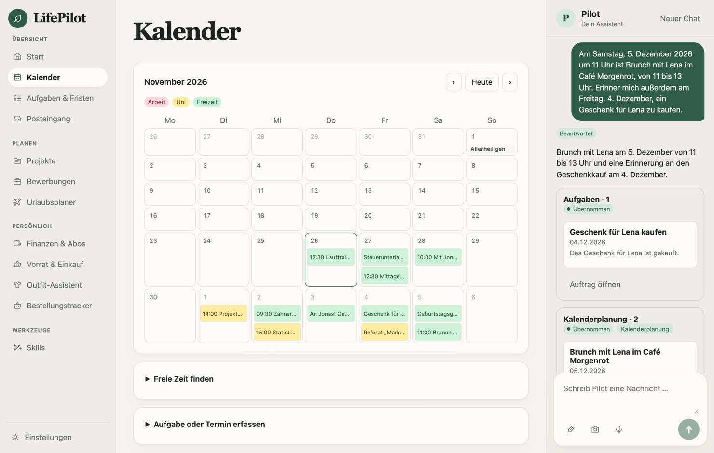
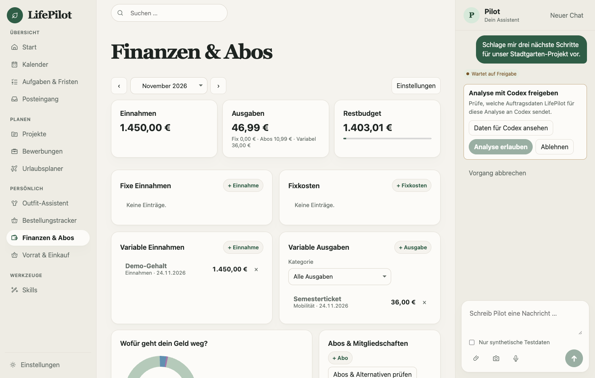
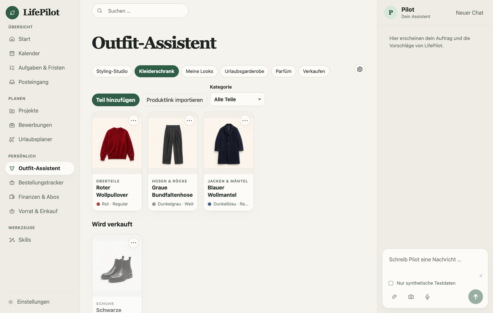
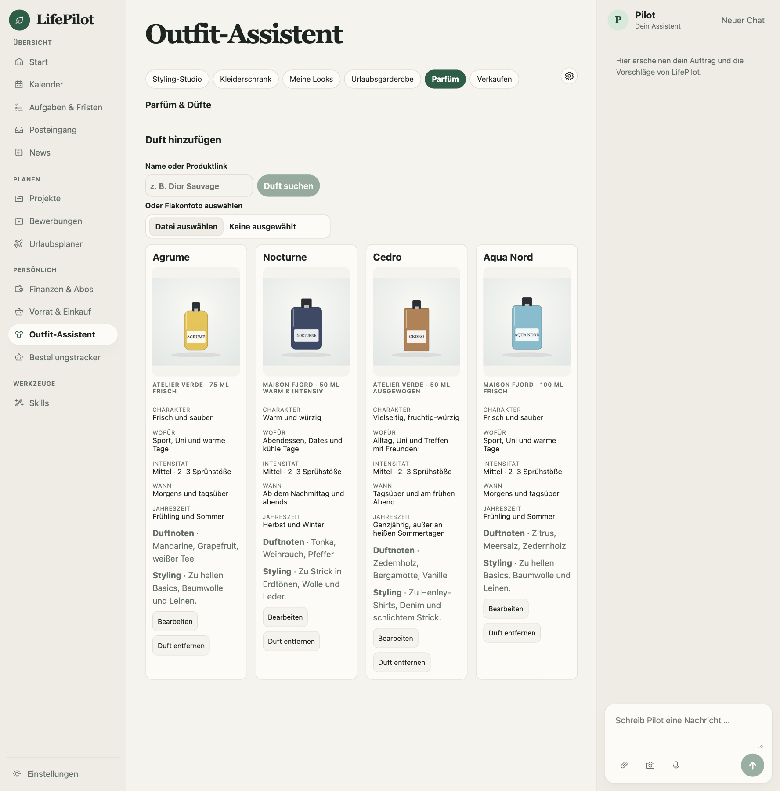

# LifePilot 1.0.6

LifePilot ist eine lokale macOS-App für persönliche Organisation. Startseite, Kalender, Aufgaben und Projekte greifen auf denselben SQLite-Datenbestand zu. Pilot hilft bei Rückfragen und bereitet Änderungsvorschläge vor.

[Aktueller Release](https://github.com/daniilobrant/lifepilot/releases/tag/v1.0.6) · [Installation](#installation) · [Screenshots](#lifepilot-im-einsatz) · [Funktionen](#funktionen) · [Skills](docs/SKILLS.md) · [Änderungsverlauf](CHANGELOG.md) · [Roadmap](#roadmap-von-01-bis-10)

## LifePilot im Einsatz

Die Aufnahmen zeigen fiktive Daten in einem getrennten Testprofil. Die Produktbilder für Kleidung und Düfte wurden für diese Demo erstellt. Klicke auf eine Aufnahme, um sie in voller Größe zu sehen.

### Planung und Pilot

<table>
<tr>
<td width="50%" valign="top"><strong>Startseite</strong> Wochenbriefing mit Aufgaben, Fristen, nächsten Terminen und wichtigen Mails. </td>
<td width="50%" valign="top"><strong>Pilot-Chat</strong> Pilot nimmt Aufträge im Chat entgegen. Du kannst einen Entwurf prüfen und eine vorgeschlagene Änderung separat bestätigen. </td>
</tr>
<tr>
<td width="50%" valign="top"><strong>Kalender</strong> Termine und Serien in der Wochen- oder Monatsansicht planen und freie Zeitfenster finden. </td>
<td width="50%" valign="top"><strong>Aufgaben &amp; Fristen</strong> Aufgaben nach Uni, Privat und Arbeit organisieren und bei Bedarf einem Projekt zuordnen. </td>
</tr>
<tr>
<td width="50%" valign="top"><strong>Projekte</strong> Phasen, Checkpoints, verknüpfte Fristen und Fortschritt auf einer Projektkarte sehen. </td>
<td width="50%" valign="top"><strong>Urlaubsplaner</strong> Reisezeitraum und Ziel auswählen, Interessen und Ausschlüsse festlegen und eine Vorschau vorbereiten. </td>
</tr>
</table>

### Posteingang, Bestellungen und Verwaltung

<table>
<tr>
<td width="50%" valign="top"><strong>Posteingang</strong> Wichtige Nachrichten priorisieren und daraus Vorschläge für passende Folgeaktionen ableiten. </td>
<td width="50%" valign="top"><strong>Bestellungstracker</strong> Lieferstatus verfolgen und je Artikel entscheiden, was behalten oder retourniert wird. </td>
</tr>
<tr>
<td width="50%" valign="top"><strong>Finanzen &amp; Abos</strong> Einnahmen, Ausgaben und Abo-Vorschläge im Monatsverlauf prüfen. </td>
<td width="50%" valign="top"><strong>Bewerbungen</strong> Bewerbungen nach Status organisieren und nächste Schritte und Gespräche planen. </td>
</tr>
</table>

### Outfit, Düfte und Haushalt

<table>
<tr>
<td width="50%" valign="top"><strong>Kleiderschrank</strong> Kleidung mit Produktbildern, Kategorien, Farben und Passformen verwalten. </td>
<td width="50%" valign="top"><strong>Parfüm &amp; Düfte</strong> Düfte mit Flakonbild, Duftnoten, Größe und passenden Anlässen sammeln. </td>
</tr>
<tr>
<td width="50%" valign="top"><strong>Styling-Studio</strong> Ein Outfit nach Anlass, Tageszeit und vorhandenen Kleidungsstücken zusammenstellen. </td>
<td width="50%" valign="top"><strong>Einkaufsliste</strong> Lebensmittel auf einer nach Warengruppen gegliederten Liste abhaken. </td>
</tr>
<tr>
<td width="50%" valign="top"><strong>Meine Looks</strong> Kombinationen und eigene Outfit-Fotos als Looks zusammenhalten. </td>
<td width="50%" valign="top"><strong>Urlaubsgarderobe</strong> Kleidungsstücke aus dem Schrank für eine konkrete Reise auswählen und als Packauswahl speichern. </td>
</tr>
<tr>
<td width="50%" valign="top"><strong>Verkaufen</strong> Für ein Kleidungsstück einen Verkaufsentwurf mit Zustand, Preisrahmen und Inseratstext erstellen. </td>
<td width="50%" valign="top"><strong>Mein Vorrat</strong> Vorräte nach Kategorien durchsuchen und den Bestand pflegen. </td>
</tr>
<tr>
<td width="50%" valign="top"><strong>Meine Rezepte</strong> Aus vorhandenen Zutaten kochen oder bei Pilot nach Rezeptideen fragen. </td>
<td width="50%"></td>
</tr>
</table>

### Skills und Einstellungen

<table>
<tr>
<td width="50%" valign="top"><strong>Skills</strong> Verfügbare Fähigkeiten und ihre Verknüpfungen mit den Modulen einsehen. </td>
<td width="50%" valign="top"><strong>Einstellungen &amp; Profil</strong> Profil für persönliche Angaben, Studium und Beruf sowie optionale Verbindungen verwalten. </td>
</tr>
</table>

[Galerie als eigene Seite](docs/SCREENSHOTS.md)

## Installation

Vorausgesetzt sind macOS, Node.js 24 ab 24.13, npm, Git und die Xcode Command Line Tools. Dieser Stand wurde auf einem Mac mit Apple Silicon geprüft. Der Download enthält Quellcode, aus dem auch die nativen Helfer gebaut werden.

    git clone --branch v1.0.6 https://github.com/daniilobrant/lifepilot.git
    cd lifepilot
    xcode-select -p
    node --version
    npm ci
    npm run build
    npm test

Fehlen die Xcode Command Line Tools, installiere sie mit **xcode-select --install**. Node muss im PATH liegen.

### Einstieg im Testprofil

    ./bin/lifepilot --acceptance start
    ./bin/lifepilot --acceptance open

Öffne **Projekte**, lege ein fiktives Projekt mit Unterpunkten an und setze für einen Punkt eine Frist. Die Frist erscheint in **Aufgaben & Fristen**. Probiere danach eine erfundene Frage als Pilot-Entwurf aus. Das Testprofil speichert seine Daten getrennt und sperrt externe Modellaufrufe und den Cloud-Reiseguide. Lokale Planung und Reisevorschauen stehen im Testprofil zur Verfügung. Verwende dort ausschließlich fiktive Daten.

    ./bin/lifepilot --acceptance stop

Für das Hauptprofil verwende dieselben Befehle ohne **--acceptance**. Die App öffnet sich lokal auf Port 45137, das Testprofil auf Port 45138. Der Checkout enthält keine Berechtigung für den persönlichen Chat und keine Kontodaten. Google und Codex sind optionale Integrationen. [Einrichtung, Datenspeicher und Grenzen](docs/SICHERHEIT.md)

## Funktionen

| Bereich | Was LifePilot unterstützt |
| --- | --- |
| Start und Pilot | Wochenübersicht, Aufgaben, Fristen, nächste Termine, wichtige Nachrichten, Rückfragen und Vorschläge zur Bestätigung |
| Kalender | Woche und Monat, Zeitfenster, Serientermine, Feiertage und gesonderte Bestätigung von Kollisionen |
| Aufgaben & Fristen | Aufgaben und Abgaben in Uni, Privat und Arbeit, mit Priorität, Datum und Projektbezug |
| Projekte | Projektkarten, Phasen, Unterpunkte, Checkpoints, Fortschritt, Archiv und Wiederherstellung |
| Posteingang | Relevante Nachrichten, gezielte Mail-Tiefenprüfung, Gmail-Kategorien und Vorschläge für Folgeaktionen |
| Bestellungstracker | Lieferungen, Retouren, Behalten und Rückerstattungen je Artikel. Behaltene Kleidung kann in den Kleiderschrank übernommen werden |
| Finanzen & Abos | Monatsübersicht, Einnahmen und Ausgaben, Abo-Vorschläge, PayPal-Absender und -Empfänger sowie Abgleich doppelter Buchungsvorschläge |
| Urlaubsplaner | Vorschau für Städte und Inseln, Reisezeiträume, Buchungen, Vorbereitung und Packlisten |
| Outfit-Assistent | Styling, Kleiderschrank, Produktlink- und Fotoimport, Looks, Urlaubsgarderobe, Verkauf und Parfüm |
| Vorrat & Einkauf | Vorratsverwaltung, kategorisierte Einkaufsliste, Belegscan und Rezeptideen |
| Bewerbungen | Bewerbungsstatus, Verlauf, Gespräche und passende Vorschläge aus E-Mails |

[Alle Skills und ihre Verknüpfungen](docs/SKILLS.md)

## Roadmap von 0.1 bis 1.0

Wir haben LifePilot mit einem lokalen Kern begonnen und ihn im Chat anhand konkreter Abläufe weiterentwickelt. Für die frühen Etappen geben die Versionsbereiche die Reihenfolge an. Der öffentliche Release ist datiert.

| Version | Was dazukam und wie wir es aufgebaut haben |
| --- | --- |
| **0.1–0.3** | Der lokale Hub und SQLite bilden die gemeinsame Basis für Browser und CLI. Darauf entstanden Aufgaben, Fristen, Erinnerungen und bestätigungspflichtige Vorschläge. |
| **0.4–0.8** | Aus den ersten Aufgaben und Terminen wurde eine Wochenplanung. Danach kamen bearbeitbare Einträge, getrennte Google-Anbindungen, Bewerbungen und der persönliche Pilot-Chat hinzu. |
| **0.9–0.13** | Outfit und Reisen bekamen eigene Ansichten. Der Kleiderschrank erhielt Bild- und Linkimport, der Posteingang Gmail-Labels und eine Auswahl relevanter Nachrichten. Mikrofon und Anhänge erweiterten den Chat. |
| **0.14–0.19** | Finanzen, Abos, Vorrat und Einkaufen wurden eigene Bereiche. Bestellungen und Retouren kamen dazu, gefolgt von Reisevorbereitung, lokaler Fotoverarbeitung und Diktat. |
| **0.20–0.24** | Wir vereinfachten typische Eingaben mit Reisevorschau und Produktlink-Import. Navigation und Pilot-Chat bekamen feste Plätze. Gmail-Kategorien, Finanzvorschläge und getrennte Profilbereiche für Studium und Beruf ergänzten die App. |
| **0.25.0–0.25.3** | Retouren wanderten aus dem Posteingang in den Bestellungstracker. PayPal-Vorschläge erhielten Gegenpartei und Verwendungszweck. Lange Reiseanfragen wie der Teneriffa-Test wurden zum Anlass, Details über mehrere Rückfragen hinweg zu erhalten. |
| **0.25.4–0.25.6** | Eine gebuchte Veranstaltung kann einen Termin und einen Ausgabenvorschlag erzeugen. Passende Zahlungsbelege werden abgeglichen. Die Mailanalyse wurde für Bestellungen, wiederkehrende Abbuchungen und weitergeleitete Uni-Nachrichten erweitert. |
| **0.25.7–0.25.12** | Werkstudenten-Pläne und Vorlesungen führten zu Kalenderserien mit Feiertagen und zweiter Bestätigung bei Überschneidungen. Neue Datumsangaben im Chat erhielten Vorrang vor früheren Vorschlägen. Projekte bekamen Phasen und Checkpoints. Verknüpfte Fristen erscheinen im eigenen Aufgabenboard. |
| **0.25.13–0.25.16** | Wir überarbeiteten die Übersichten anhand der App-Ansichten. Einkauf wurde nach Kategorien gegliedert, Vorratsaktionen neu ausgerichtet und das Reiseformular um Ortssuche und auswählbare Interessen ergänzt. |
| **1.0 · 24. November 2026** | Die öffentliche Ausgabe bündelt die Module mit einer Anleitung, der Screenshot-Galerie und detaillierten Skills. Die Sicherheitsprüfung führte zur Google-Kontobindung für Kalenderschreibzugriffe, zur Signaturprüfung privater Releases und zur Umstellung der modellgestützten Bildanalyse auf Codex CLI. |

[Alle Einzelschritte im Changelog](CHANGELOG.md) · [Planungsentscheidungen und offene Vorhaben](docs/ROADMAP.md) · [Teststatus](TESTSTATUS.md)

## Technik

Das React-Frontend und der CLI-Adapter greifen auf denselben Node.js-Hub zu. SQLite speichert Daten je Profil. Die Laufzeit prüft Agentenantworten gegen ein Schema und übernimmt bestätigte Änderungen. Mit **./bin/lifepilot help** findest du die Terminalaktionen. [Hub](hub) · [Agenten und Tests](agents)

Der öffentliche Git-Verlauf beginnt mit einem bereinigten Import. Dieser Release erteilt keine zusätzliche Open-Source-Lizenz.
