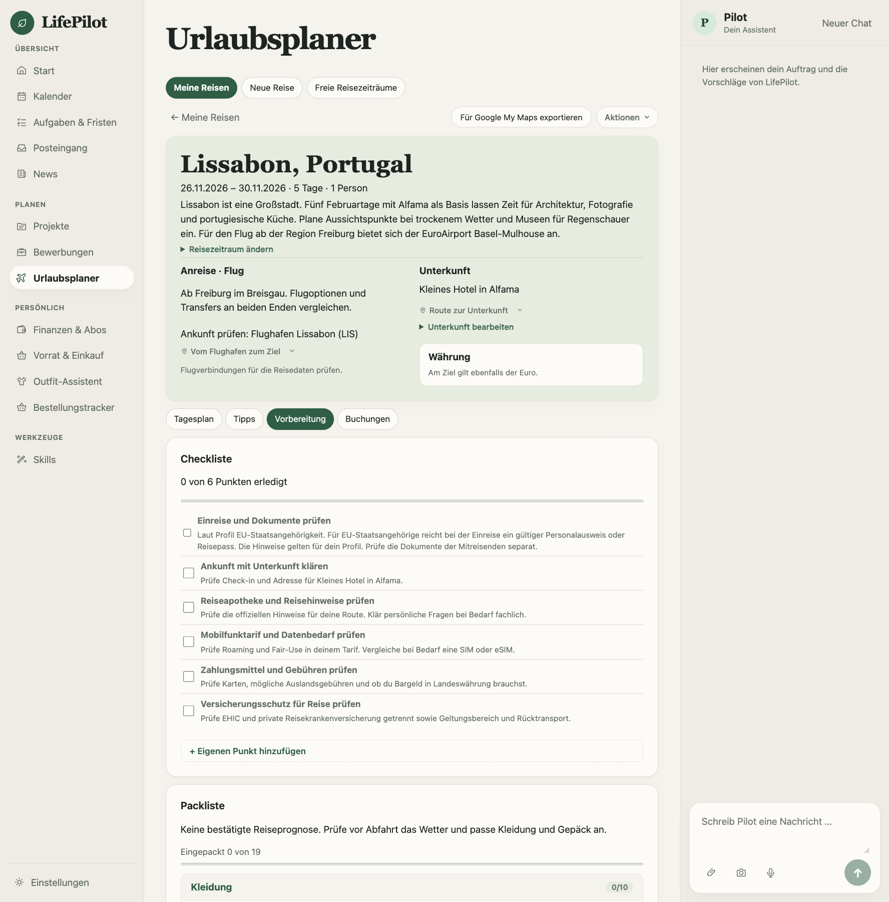
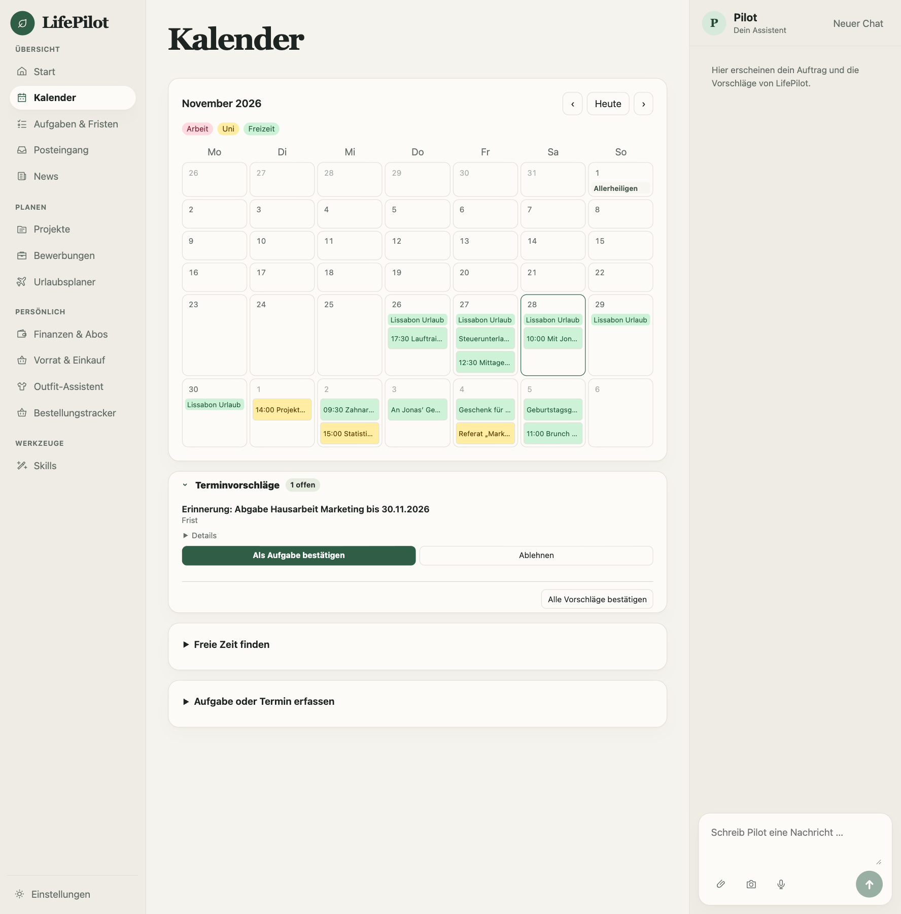

# LifePilot 1.1.0

LifePilot ist eine lokale macOS-App für persönliche Organisation. Startseite, Kalender, Aufgaben und Projekte greifen auf denselben SQLite-Datenbestand zu. Pilot hilft bei Rückfragen und bereitet Änderungsvorschläge vor.

[Installation](#installation) · [Screenshots](#lifepilot-im-einsatz) · [Funktionen](#funktionen) · [Skills](docs/SKILLS.md) · [Versionsübersicht](#versionsübersicht) · [Entwicklungsverlauf](docs/ENTWICKLUNG.md) · [Sicherheitsbericht](SECURITY_REPORT.md)

## LifePilot im Einsatz

Die Aufnahmen zeigen fiktive Daten in einem getrennten Testprofil. Die Produktbilder für Kleidung und Düfte wurden für diese Demo erstellt. Klicke auf eine Aufnahme, um sie in voller Größe zu sehen.

### Planung und Pilot

<table>
<tr>
<td width="50%" valign="top"><strong>Startseite</strong> Wochenbriefing mit Aufgaben, Fristen, nächsten Terminen und wichtigen Mails. </td>
<td width="50%" valign="top"><strong>Pilot-Chat</strong> Pilot nimmt Aufträge im Chat entgegen. Aus einer einzigen Nachricht entstehen ein Kalendertermin und eine Aufgabe mit Erinnerung; du bestätigst jeden Vorschlag einzeln. </td>
</tr>
<tr>
<td width="50%" valign="top"><strong>Kalender</strong> Termine und Serien in der Wochen- oder Monatsansicht planen und freie Zeitfenster finden. </td>
<td width="50%" valign="top"><strong>Aufgaben &amp; Fristen</strong> Aufgaben nach Uni, Privat und Arbeit organisieren und bei Bedarf einem Projekt zuordnen. </td>
</tr>
<tr>
<td width="50%" valign="top"><strong>Projekte</strong> Phasen, Checkpoints, verknüpfte Fristen und Fortschritt auf einer Projektkarte sehen. </td>
<td width="50%" valign="top"><strong>Urlaubsplaner</strong> Reiseplan mit Anreise, Unterkunft, Währung und Tagesplan, Tipps und Buchungen für jeden Reisetag. </td>
</tr>
<tr>
<td width="50%" valign="top"><strong>Reisevorbereitung</strong> Checkliste und Packliste einer Reise lassen sich abhaken und nach Bedarf anpassen. </td>
<td width="50%"></td>
</tr>
</table>

### Posteingang, Bestellungen und Verwaltung

<table>
<tr>
<td width="50%" valign="top"><strong>Posteingang</strong> Wichtige Nachrichten priorisieren und begründen, warum sie wichtig sind. </td>
<td width="50%" valign="top"><strong>Terminvorschläge</strong> Aus Mails abgeleitete Termine, Fristen und Aufgaben stehen unter dem Kalender und lassen sich einzeln oder gesammelt übernehmen. </td>
</tr>
<tr>
<td width="50%" valign="top"><strong>Bestellungstracker</strong> Lieferstatus verfolgen und je Artikel entscheiden, was behalten oder retourniert wird. </td>
<td width="50%" valign="top"><strong>Finanzen &amp; Abos</strong> Einnahmen, Ausgaben, Fixkosten und Abos im Monatsverlauf prüfen. </td>
</tr>
<tr>
<td width="50%" valign="top"><strong>Abo-Prüfung</strong> Pilot sucht im Web nach günstigeren Tarifen und sagt je Abo, ob es sich lohnt zu wechseln. Gekündigt oder gebucht wird nichts. </td>
<td width="50%" valign="top"><strong>Bewerbungen</strong> Bewerbungen nach Status organisieren, Gespräche planen und Vorschläge aus Mails mit „Passt“ bestätigen. </td>
</tr>
</table>

### Outfit, Düfte und Haushalt

<table>
<tr>
<td width="50%" valign="top"><strong>Kleiderschrank</strong> Kleidung mit Produktbildern, Kategorien, Farben und Passformen verwalten. </td>
<td width="50%" valign="top"><strong>Parfüm &amp; Düfte</strong> Düfte mit Flakonbild, Duftnoten, Größe und passenden Anlässen sammeln. </td>
</tr>
<tr>
<td width="50%" valign="top"><strong>Styling-Studio</strong> Ein Outfit nach Anlass, Tageszeit, Wetter und vorhandenen Kleidungsstücken zusammenstellen, passend mit Duft. </td>
<td width="50%" valign="top"><strong>Einkaufsliste</strong> Lebensmittel auf einer nach Warengruppen gegliederten Liste abhaken. </td>
</tr>
<tr>
<td width="50%" valign="top"><strong>Meine Looks</strong> Kombinationen und eigene Outfit-Fotos als Looks zusammenhalten. </td>
<td width="50%" valign="top"><strong>Urlaubsgarderobe</strong> Kleidungsstücke aus dem Schrank für eine konkrete Reise auswählen und als Packauswahl speichern. </td>
</tr>
<tr>
<td width="50%" valign="top"><strong>Verkaufen</strong> Für ein Kleidungsstück einen Verkaufsentwurf mit Zustand, Preisrahmen und Inseratstext erstellen. </td>
<td width="50%" valign="top"><strong>Mein Vorrat</strong> Vorräte nach Kategorien durchsuchen und den Bestand pflegen. </td>
</tr>
<tr>
<td width="50%" valign="top"><strong>Meine Rezepte</strong> Aus vorhandenen Zutaten kochen oder bei Pilot nach Rezeptideen fragen; fehlende Zutaten wandern auf die Einkaufsliste. </td>
<td width="50%"></td>
</tr>
</table>

### Skills und Einstellungen

<table>
<tr>
<td width="50%" valign="top"><strong>Skills</strong> Verfügbare Fähigkeiten und ihre Verknüpfungen mit den Modulen einsehen. </td>
<td width="50%" valign="top"><strong>Einstellungen &amp; Profil</strong> Profil für persönliche Angaben, Studium und Beruf sowie optionale Verbindungen verwalten. </td>
</tr>
</table>

[Galerie als eigene Seite](docs/SCREENSHOTS.md)

## Installation

Vorausgesetzt sind macOS, Node.js 24 ab 24.13, npm, Git und die Xcode Command Line Tools. Dieser Stand wurde auf einem Mac mit Apple Silicon geprüft. Der Download enthält Quellcode, aus dem auch die nativen Helfer gebaut werden.

    git clone https://github.com/daniilobrant/lifepilot.git
    cd lifepilot
    xcode-select -p
    node --version
    npm ci
    npm run build
    npm test

Fehlen die Xcode Command Line Tools, installiere sie mit **xcode-select --install**. Node muss im PATH liegen.

### Einstieg im Testprofil

    ./bin/lifepilot --acceptance start
    ./bin/lifepilot --acceptance open

Öffne **Projekte**, lege ein fiktives Projekt mit Unterpunkten an und setze für einen Punkt eine Frist. Die Frist erscheint in **Aufgaben & Fristen**. Probiere danach eine erfundene Frage als Pilot-Entwurf aus. Das Testprofil speichert seine Daten getrennt und sperrt externe Modellaufrufe und den Cloud-Reiseguide. Lokale Planung und Reisevorschauen stehen im Testprofil zur Verfügung. Verwende dort ausschließlich fiktive Daten.

    ./bin/lifepilot --acceptance stop

Für das Hauptprofil verwende dieselben Befehle ohne **--acceptance**. Die App öffnet sich lokal auf Port 45137, das Testprofil auf Port 45138. Der Checkout enthält keine Berechtigung für den persönlichen Chat und keine Kontodaten. Google, Codex und Claude Code sind optionale Integrationen. [Einrichtung, Datenspeicher und Grenzen](docs/SICHERHEIT.md)

## KI-Anbindung: Codex oder Claude Code

Pilot, der Reiseguide und die Bildanalyse nutzen ein Sprachmodell über eine lokal installierte Kommandozeile. LifePilot unterstützt zwei Anbieter, umschaltbar unter **Einstellungen › Übersicht › Agenten-Chat**:

| | Codex (Standard) | Claude Code |
|---|---|---|
| Anbieter | OpenAI | Anthropic |
| Programm | Codex CLI aus der ChatGPT-App für macOS | Claude Code CLI |
| Abrechnung | ChatGPT-Konto bzw. Codex-Kontingent | Claude-Abo (Pro/Max) |

**So funktioniert die Anbindung:** Jede Pilot-Nachricht wird lokal vorbereitet – ein kompaktes Verzeichnis deiner Termine, Aufgaben, Projekte, Abos, Bestellungen, Bewerbungen und Reisen ([agent-directory.ts](hub/runtime/agent-directory.ts)) und eine Vorzerlegung langer, diktierter Nachrichten ([message-analysis.ts](hub/runtime/message-analysis.ts)). Zusammen mit den [Skills](agents/lifepilot/skills) und einer Entscheidungstabelle ([routing](agents/lifepilot/skills/routing/SKILL.md)) geht das an das Modell. Das Modell muss in einem festen JSON-Format antworten ([output.schema.json](agents/lifepilot/output.schema.json)); LifePilot prüft die Antwort ([validate.ts](agents/lifepilot/tools/validate.ts)) und speichert erst nach deiner Freigabe. Das Modell läuft ohne Werkzeuge, ohne Shell, Dateien, Web oder MCP-Server ([codex.ts](hub/adapters/codex.ts), [claude.ts](hub/adapters/claude.ts)).

### Schritt 1: Privaten Chat freigeben

Der Chat im Hauptprofil arbeitet nur mit einer lokalen Freigabe für genau den installierten Build: `user-data/local/private-chat-release.json` mit `version`, `approved: true`, `manifest` (SHA-256 der Datei `SHA256SUMS`) und `ui` (SHA-256 von `dist/app.js`). Ohne gültige Freigabe bleibt der Chat aus. [Details](docs/SICHERHEIT.md)

### Schritt 2a: Codex anbinden

1. ChatGPT-App für macOS installieren und anmelden. Die App bringt die Codex CLI mit (`/Applications/ChatGPT.app/Contents/Resources/codex-cli`).
2. In LifePilot unter **Einstellungen › Übersicht** „Codex (ChatGPT)“ wählen. LifePilot prüft vor jedem Aufruf die Signatur der Codex CLI.

### Schritt 2b: Claude Code anbinden

1. Claude Code CLI installieren (offizieller Installer von Anthropic):

       curl -fsSL https://claude.ai/install.sh | bash

2. Den Installationsordner in den Suchpfad aufnehmen, falls `claude` danach „command not found“ meldet:

       echo 'export PATH="$HOME/.local/bin:$PATH"' >> ~/.zshrc && source ~/.zshrc

3. `claude` starten, das Farbschema bestätigen und **„Claude account with subscription“** wählen; die Anmeldung im Browser bestätigen. Mit `/exit` beenden.
4. In LifePilot unter **Einstellungen › Übersicht** „Claude (Claude Code CLI)“ wählen. LifePilot findet die CLI unter `~/.local/bin/claude` und nutzt deren Anmeldung aus dem macOS-Schlüsselbund.

### Schritt 3: Anbindung prüfen

    npm test                 # 219 Tests ohne Modell, u. a. Verzeichnis, Vorzerlegung, Bewertung
    npm run eval:chat        # 48 Beispielsätze live gegen das eingestellte Modell

`npm run eval:chat` läuft im installierten Hauptprofil mit Freigabe und verbraucht Modellkontingent. Es prüft einzelne Skills, Kombinationen aus zwei und drei Skills, Diktatfehler („Kai und Data Science“, „B2Bar.“), Fragen zu eigenen Daten und Rückfragen bei unklaren Aufträgen ([Testfälle](agents/lifepilot/evals/chat-cases.json)). Das Ergebnis steht in `agents/lifepilot/evals/LAST_RUN.md`.

### Die Einrichtung einer KI überlassen

Codex oder Claude Code können die Anbindung selbst übernehmen. Öffne das geklonte Repository in Codex bzw. Claude Code und gib diesen Auftrag:

> Richte LifePilot auf diesem Mac mit **[Codex | Claude Code]** als Modell ein. Lies zuerst README.md und docs/SICHERHEIT.md. Führe `npm ci`, `npm run build` und `npm test` aus. Prüfe, ob die gewählte CLI installiert und angemeldet ist; falls nicht, nenne mir die Befehle, die ich selbst ausführe – Anmeldungen und Passwörter gebe ich selbst ein. Erstelle die private Chat-Freigabe für den gebauten Stand nur nach meiner Bestätigung, starte die App mit `./bin/lifepilot start`, stelle in den Einstellungen den Anbieter ein und führe danach `npm run eval:chat` aus. Fasse zusammen, welche Fälle bestanden haben und welche nicht.

## Funktionen

| Bereich | Was LifePilot unterstützt |
| --- | --- |
| Start und Pilot | Wochenübersicht, Aufgaben, Fristen, nächste Termine, wichtige Nachrichten, Rückfragen und Vorschläge zur Bestätigung |
| Kalender | Woche und Monat, Zeitfenster, Serientermine, Feiertage und gesonderte Bestätigung von Kollisionen |
| Aufgaben & Fristen | Aufgaben und Abgaben in Uni, Privat und Arbeit, mit Priorität, Datum und Projektbezug |
| Projekte | Projektkarten, Phasen, Unterpunkte, Checkpoints, Fortschritt, Archiv und Wiederherstellung |
| Posteingang | Relevante Nachrichten, per Klick nach Kategorie filterbar (falsche Zuordnung per Stift korrigierbar), gezielte Mail-Tiefenprüfung und Vorschläge für Folgeaktionen. Auf der Startseite stehen nur wichtige Nachrichten von echten Personen |
| Terminvorschläge | Aus Mails abgeleitete Termine, Fristen und Aufgaben als aufklappbare Liste unter dem Kalender |
| Bestellungstracker | Lieferungen, Retouren, Behalten und Rückerstattungen je Artikel. Behaltene Kleidung kann in den Kleiderschrank übernommen werden |
| Finanzen & Abos | Monatsübersicht, Einnahmen und Ausgaben, Abo-Vorschläge, PayPal-Absender und -Empfänger sowie Abgleich doppelter Buchungsvorschläge |
| Urlaubsplaner | Vorschau für Städte und Inseln, Reisezeiträume, Buchungen, Vorbereitung und Packlisten |
| Outfit-Assistent | Styling, Kleiderschrank, Produktlink- und Fotoimport, Looks, Urlaubsgarderobe, Verkauf und Parfüm |
| Vorrat & Einkauf | Vorratsverwaltung, kategorisierte Einkaufsliste, Belegscan und Rezeptideen |
| Bewerbungen | Bewerbungsstatus, Verlauf, Gespräche und passende Vorschläge aus E-Mails |

[Alle Skills und ihre Verknüpfungen](docs/SKILLS.md)

### Was Pilot im Chat verknüpft

Pilot kennt ein kompaktes Verzeichnis deiner Daten und ordnet jede Nachricht dem passenden Bereich zu. Mehrere Anliegen in einer Nachricht werden getrennt vorgeschlagen und einzeln von dir bestätigt. Jeder Bereich ist mit den anderen verknüpft:

| Du schreibst … | Pilot bereitet vor … | Verknüpft mit |
| --- | --- | --- |
| „Zahnarzt am 3.12. um 10 Uhr“ | Kalendertermin mit Dauer, Kollisionsprüfung | Aufgaben, Freie Zeit, Projekte |
| „Jeden Dienstag 18 Uhr Volleyball“ | Terminserie mit Feiertagsausnahmen | Kalender, Freie Zeit |
| „Morgen präsentieren“, „Abgabe am 15.“ | Aufgabe mit Frist, optional mit Termin oder Projekt verlinkt | Kalender, Projekte, Frist-Wächter |
| „Wann habe ich diese Woche 2 Stunden?“ | Freie Zeitfenster aus Kalender und Fristen | Kalender, Aufgaben |
| „Füg der Bachelorarbeit den Schritt Literatur hinzu“ | Projektschritt mit Phase, Frist und Zeitblöcken | Aufgaben, Kalender |
| „12 € fürs Kino“, „Netflix kostet 13 €“ | Buchung oder Abo, Monatsübersicht, Abgleich doppelter Buchungen | Finanzen, PayPal, Posteingang |
| „Setz Milch auf die Liste“, „Eier sind leer“ | Einkaufsliste und Vorrat | Rezepte, Belegscan |
| „Was koche ich mit meinem Vorrat?“ | Rezeptideen mit Fleisch, vegetarisch oder Zutatenwunsch; fehlende Zutaten auf die Liste | Vorrat, Einkauf |
| „Was ziehe ich zum Vorstellungsgespräch an?“ | Outfit aus dem Kleiderschrank mit Basisschicht, Farbpalette und Duft | Bewerbungen, Kalender, Urlaubsgarderobe |
| „Plan 4 Tage Lissabon im März“ | Reisevorschau, Zeitraum, Packliste, Garderobe | Kalender, Outfit, Finanzen |
| „Ich habe mich bei Bosch beworben“ | Bewerbungsstatus, Gespräch als Termin | Posteingang, Outfit, Aufgaben |
| „Die Jeans schicke ich zurück“ | Entscheidung je Artikel (behalten, Retoure), Kleiderschrank | Bestellungen, Posteingang, Finanzen |
| „Schau in meine Mails“ | Relevante Nachrichten mit Vorschlägen für Termine, Fristen, Bestellungen | Posteingang, Kalender, Aufgaben |
| „Was steht als Nächstes an?“ | Antwort aus deinem Verzeichnis (Termine, Projektschritte, Abos) | alle Bereiche |

**Rückfragen mit Kurzantworten.** Fehlt eine Angabe, stellt Pilot genau eine gezielte Frage und zeigt dazu anklickbare Antworten, etwa „Bis 16 Uhr“, „Bis 17 Uhr“ oder „Ja“ und „Nein“. „Etwas anderes …“ ist immer dabei und führt in das Eingabefeld. Ein Klick sendet die Antwort wie eine getippte Nachricht. Beginnt die Antwort ein neues Anliegen, bearbeitet Pilot es neu und übernimmt nichts aus der offenen Frage. Die Kurzantworten sind reiner Text, werden lokal geprüft und lösen nichts aus, was du nicht auch tippen könntest.

## Versionsübersicht

LifePilot begann mit einem lokalen Kern und wurde anhand konkreter Abläufe gemeinsam mit KI-Assistenten weiterentwickelt. Für die frühen Etappen geben die Versionsbereiche die Reihenfolge an, ab dem öffentlichen Release sind die Tage datiert. Wie die Zusammenarbeit ablief, beschreibt der [Entwicklungsverlauf](docs/ENTWICKLUNG.md).

| Version | Was dazukam und wie wir es aufgebaut haben |
| --- | --- |
| **0.1–0.3** | Der lokale Hub und SQLite bilden die gemeinsame Basis für Browser und CLI. Darauf entstanden Aufgaben, Fristen, Erinnerungen und bestätigungspflichtige Vorschläge. |
| **0.4–0.8** | Aus den ersten Aufgaben und Terminen wurde eine Wochenplanung. Danach kamen bearbeitbare Einträge, getrennte Google-Anbindungen, Bewerbungen und der persönliche Pilot-Chat hinzu. |
| **0.9–0.13** | Outfit und Reisen bekamen eigene Ansichten. Der Kleiderschrank erhielt Bild- und Linkimport, der Posteingang Gmail-Labels und eine Auswahl relevanter Nachrichten. Mikrofon und Anhänge erweiterten den Chat. |
| **0.14–0.19** | Finanzen, Abos, Vorrat und Einkaufen wurden eigene Bereiche. Bestellungen und Retouren kamen dazu, gefolgt von Reisevorbereitung, lokaler Fotoverarbeitung und Diktat. |
| **0.20–0.24** | Wir vereinfachten typische Eingaben mit Reisevorschau und Produktlink-Import. Navigation und Pilot-Chat bekamen feste Plätze. Gmail-Kategorien, Finanzvorschläge und getrennte Profilbereiche für Studium und Beruf ergänzten die App. |
| **0.25.0–0.25.3** | Retouren wanderten aus dem Posteingang in den Bestellungstracker. PayPal-Vorschläge erhielten Gegenpartei und Verwendungszweck. Lange Reiseanfragen wie der Teneriffa-Test wurden zum Anlass, Details über mehrere Rückfragen hinweg zu erhalten. |
| **0.25.4–0.25.6** | Eine gebuchte Veranstaltung kann einen Termin und einen Ausgabenvorschlag erzeugen. Passende Zahlungsbelege werden abgeglichen. Die Mailanalyse wurde für Bestellungen, wiederkehrende Abbuchungen und weitergeleitete Uni-Nachrichten erweitert. |
| **0.25.7–0.25.12** | Werkstudenten-Pläne und Vorlesungen führten zu Kalenderserien mit Feiertagen und zweiter Bestätigung bei Überschneidungen. Neue Datumsangaben im Chat erhielten Vorrang vor früheren Vorschlägen. Projekte bekamen Phasen und Checkpoints. Verknüpfte Fristen erscheinen im eigenen Aufgabenboard. |
| **0.25.13–0.25.16** | Wir überarbeiteten die Übersichten anhand der App-Ansichten. Einkauf wurde nach Kategorien gegliedert, Vorratsaktionen neu ausgerichtet und das Reiseformular um Ortssuche und auswählbare Interessen ergänzt. |
| **1.0 · 24. November 2026** | Die öffentliche Ausgabe bündelt die Module mit einer Anleitung, der Screenshot-Galerie und detaillierten Skills. Die Sicherheitsprüfung führte zur Google-Kontobindung für Kalenderschreibzugriffe, zur Signaturprüfung privater Releases und zur Umstellung der modellgestützten Bildanalyse auf Codex CLI. |
| **1.0.1–1.0.10 · 24./25. November 2026** | Kleiderschrank mit Kategorien, Verkaufskarten und Urlaubsgarderobe, lokale Freigabe des privaten Chats, Rezepte mit Portionen und Mengenabgleich, kompaktere Reiseformulare. |
| **1.0.11–1.0.35 · 25. November 2026** | Zahlungs- und Erstattungserkennung aus Mails (Händler, Apple, Fahrdienste), Bestellungstracker für Amazon und weitere Shops, paralleler Reiseguide mit Währungsrechner, Vorrat mit Einheiten, Outfit mit Farbpalette, Projekte nach Frist, aufgeräumte Bearbeitung von Terminen. |
| **1.0.36–1.0.42 · 25./26. November 2026** | Agent mit Verzeichnis aller Bereiche, Zerlegung langer und diktierter Nachrichten, Entscheidungstabelle der Skills, Bestellungen und Bewerbungen im Chat, umschaltbarer Modellanbieter (Codex oder Claude Code), Testsatz mit 48 Beispielsätzen. |
| **1.0.43–1.0.52 · 26. November 2026** | Sicherheitsprüfung des Gesamtprojekts, Kalender ohne Doppeleinträge, Rezeptauswahl und Zutatenabgleich, Bestellmails mit Warenkorb-Blöcken, Outfits passend zum Anlass, Terminvorschläge aus Mails. |
| **1.0.53–1.0.57 · 26. November 2026** | Tiefere Mailprüfung per Modell, Löschen von Mails mit Bestätigung, Wetterfragen am Standort, wichtige Mails der letzten sieben Tage, schonender Mailabruf. |
| **1.0.58–1.1.0 · 26. November 2026** | Weitergeleitete Kurs-Mails als Terminvorschlag, Sicherheitsaudit mit lokalem Prüfbefehl und Bereinigung privater Daten. Pilot versteht Themenwechsel mitten in einer Rückfrage und bietet Kurzantworten zum Anklicken an. |

[Entwicklungsverlauf](docs/ENTWICKLUNG.md)

## Technik

Das React-Frontend und der CLI-Adapter greifen auf denselben Node.js-Hub zu. SQLite speichert Daten je Profil. Die Laufzeit prüft Agentenantworten gegen ein Schema und übernimmt bestätigte Änderungen. Mit **./bin/lifepilot help** findest du die Terminalaktionen. [Hub](hub) · [Agenten und Tests](agents)

Der öffentliche Git-Verlauf beginnt mit einem bereinigten Import. Dieser Release erteilt keine zusätzliche Open-Source-Lizenz.
