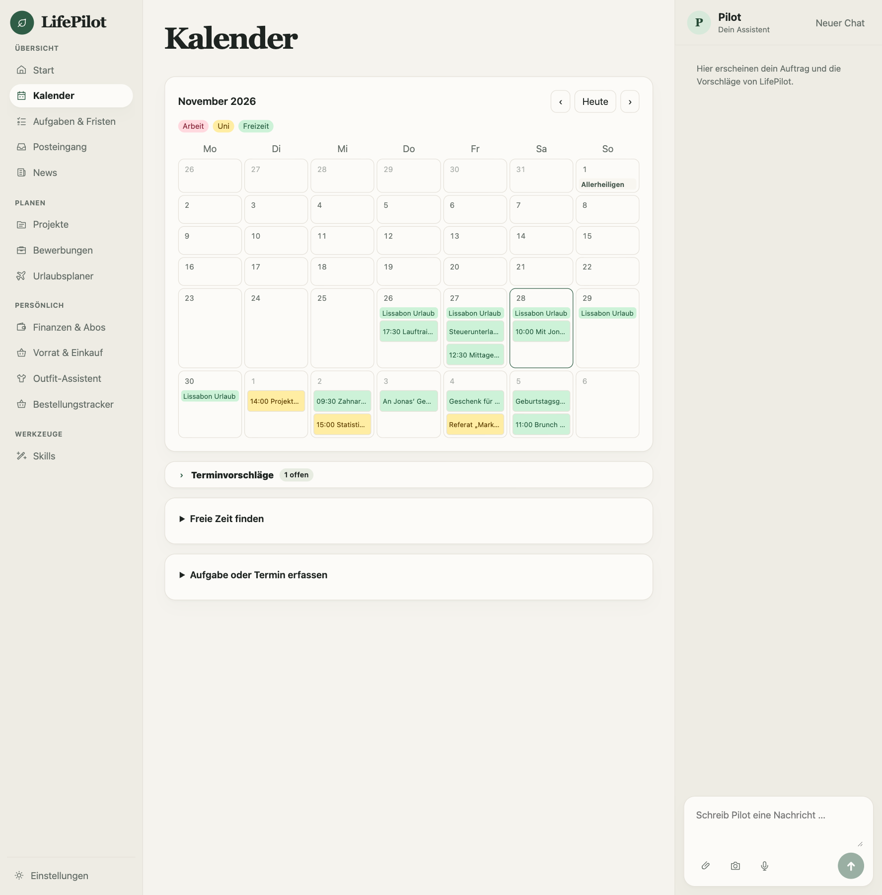
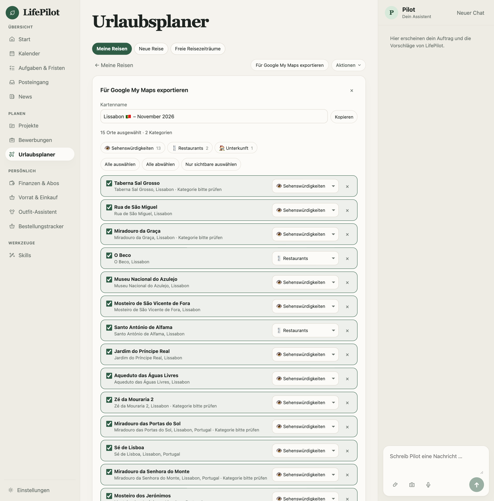
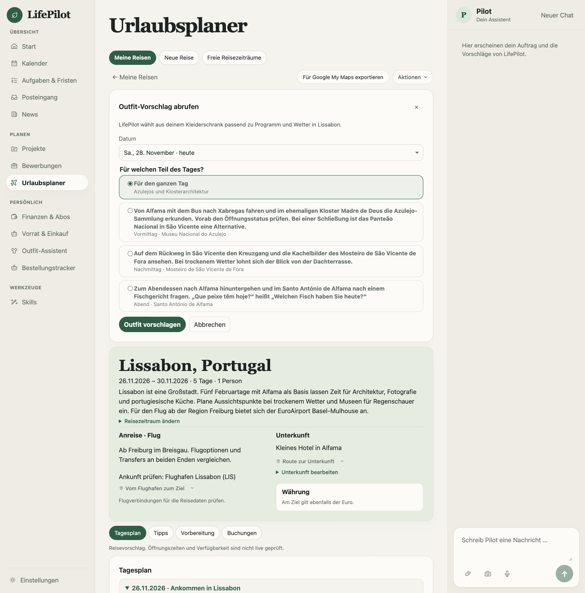
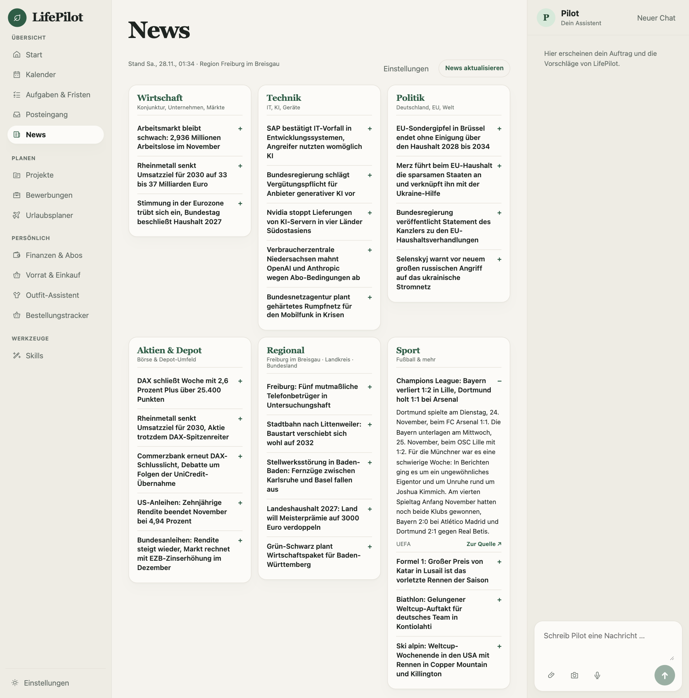
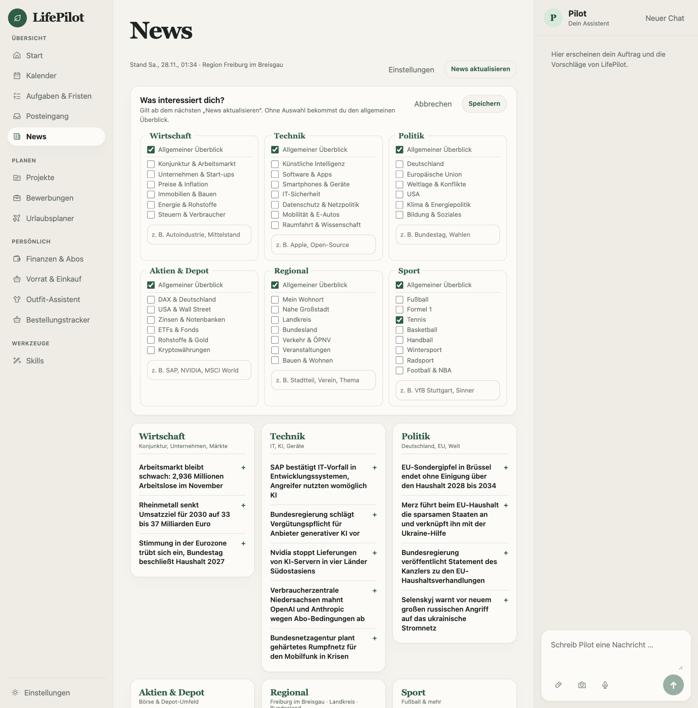
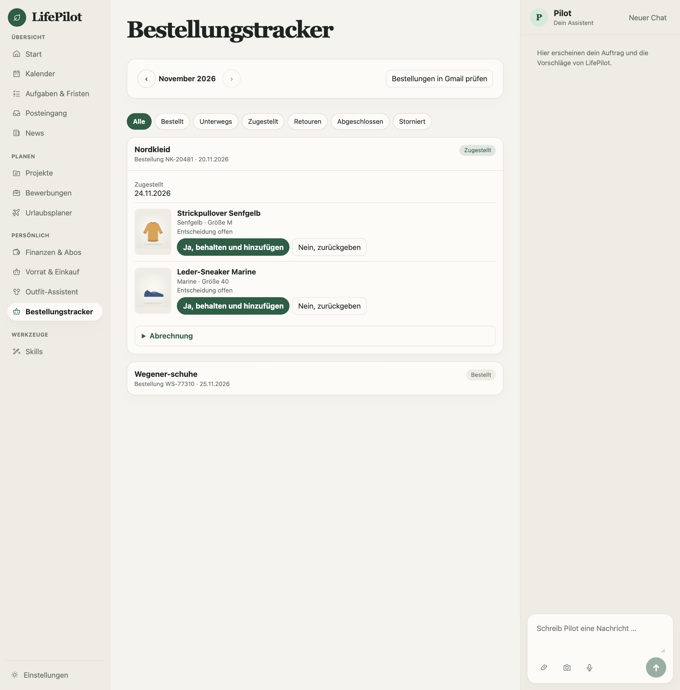
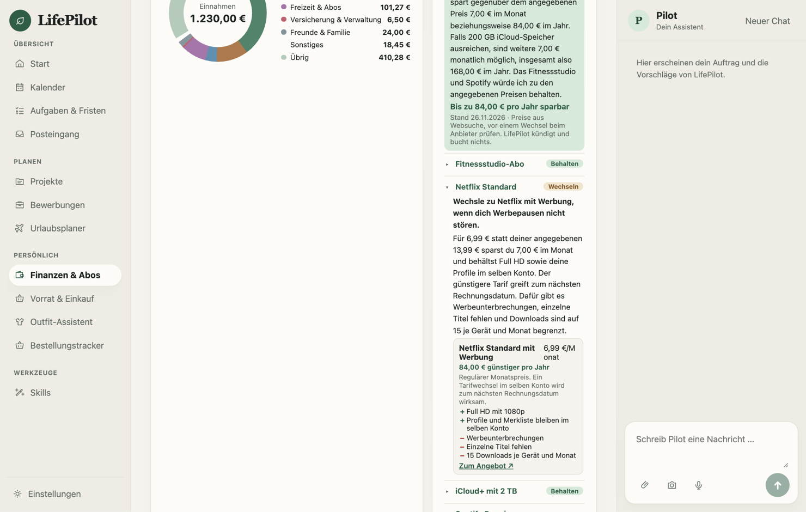
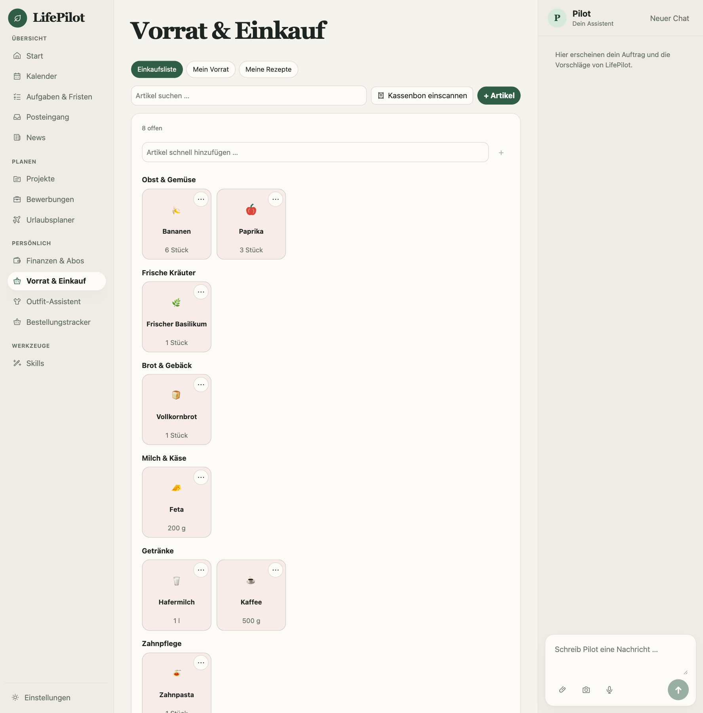
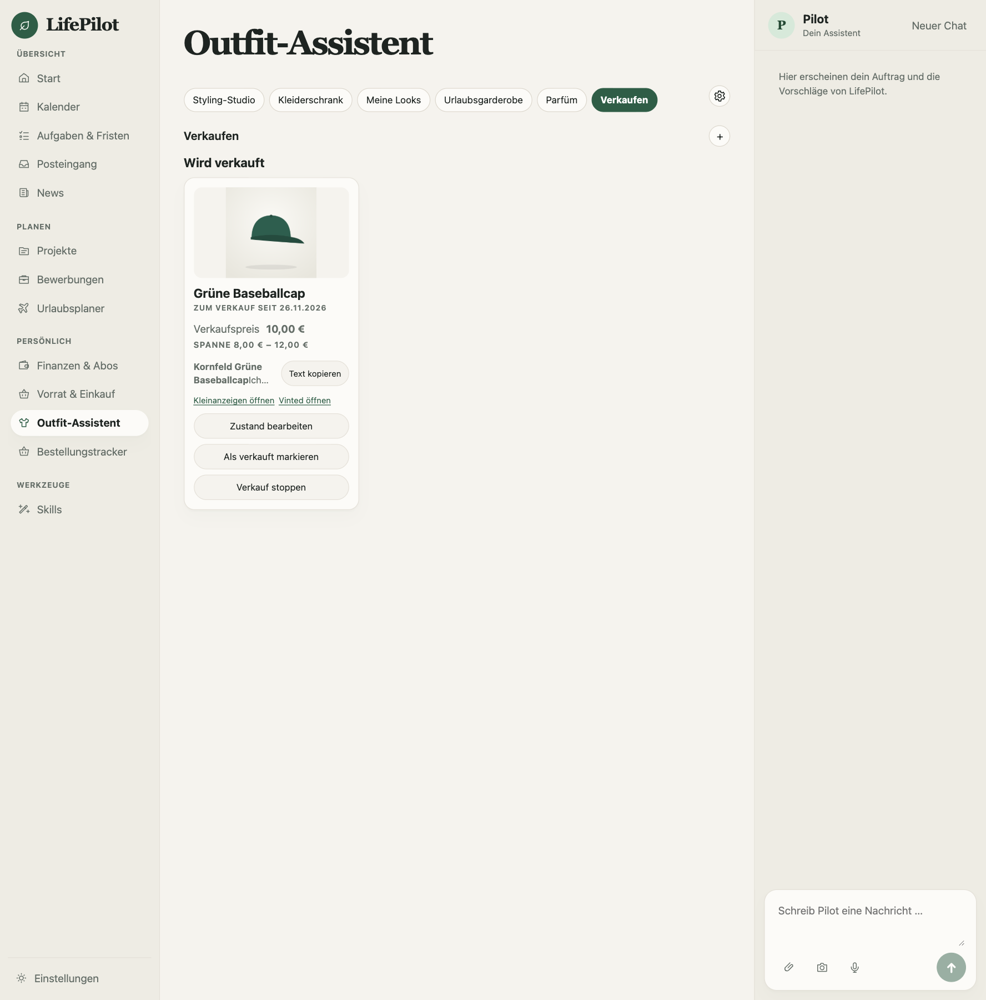
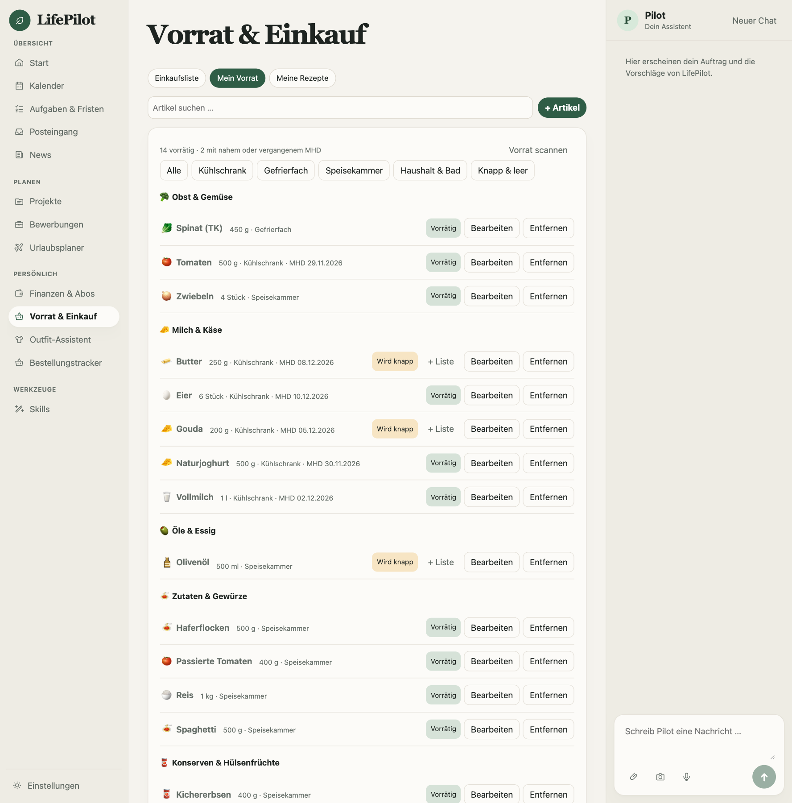

# LifePilot im Testprofil

Alle Aufnahmen zeigen die Version 1.3.6 mit vollständig fiktiven Daten (Person, Termine, Mails, Bestellungen, Finanzen, Bewerbungen). Sie entstanden in einem getrennten Testprofil. Pilot-Chat, Styling-Studio, Rezeptideen, Reiseplan und Abo-Prüfung wurden mit dem echten Modell erzeugt; die Mails und Bestellungen sind Musterdaten, kein Google-Konto war verbunden. Die Kleidungs- und Flakonbilder sind generierte Beispielmotive. Wetterdaten stammen von Open-Meteo, Tarifangaben der Abo-Prüfung aus einer Websuche und können abweichen. Das News-Briefing entstand am 28. November 2026 mit dem echten Modell und Websuche für die fiktive Person (Wohnort Freiburg); die Meldungen sind echt und über die Quelle prüfbar.

## Planung und Pilot

### Startseite

Wochenbriefing mit Aufgaben, Fristen, nächsten Terminen und wichtigen Mails.

### Pilot-Chat

Pilot nimmt Aufträge im Chat entgegen. Aus einer einzigen Nachricht entstehen ein Kalendertermin und eine Aufgabe mit Erinnerung; du bestätigst jeden Vorschlag einzeln.

### Kalender

Termine und Serien in der Wochen- oder Monatsansicht planen und freie Zeitfenster finden.

### Aufgaben & Fristen

Aufgaben nach Uni, Privat und Arbeit organisieren und bei Bedarf einem Projekt zuordnen.

### Projekte

Phasen, Checkpoints, verknüpfte Fristen und Fortschritt auf einer Projektkarte sehen.

### Urlaubsplaner

Reiseplan mit Anreise, Unterkunft, Währung und Tagesplan, Tipps und Buchungen für jeden Reisetag.

### Reisevorbereitung

Checkliste und Packliste einer Reise lassen sich abhaken und nach Bedarf anpassen.

### Kartenexport für Google My Maps

Orte der Reise nach Kategorien auswählen, den Kartennamen kopieren und als CSV, ZIP oder KML für Google My Maps herunterladen.

### Outfit-Vorschlag im Urlaub

Ab einem Tag vor der Abreise bis zum Reiseende: Datum und Tagesabschnitt wählen, Pilot stellt ein Outfit aus dem Kleiderschrank zusammen. Es landet im Styling-Studio und lässt sich unter „Urlaub“ speichern.

## News

### News-Briefing

Auf Knopfdruck sammelt Pilot je Bereich drei bis fünf aktuelle Meldungen aus festen Quellen. Zugeklappt steht nur die Schlagzeile, aufgeklappt die Einordnung mit Link zur Quelle. Das Briefing bleibt bis zur nächsten Aktualisierung gespeichert.

### News-Einstellungen

Ein kleiner Fragebogen je Bereich: allgemeiner Überblick oder gezielte Schwerpunkte per Kästchen, dazu ein Freitextfeld für Vereine, Werte oder Begriffe.

## Posteingang, Bestellungen und Verwaltung

### Posteingang

Wichtige Nachrichten priorisieren und begründen, warum sie wichtig sind.

### Terminvorschläge

Aus Mails abgeleitete Termine, Fristen und Aufgaben stehen unter dem Kalender und lassen sich einzeln oder gesammelt übernehmen.

### Bestellungstracker

Lieferstatus verfolgen und je Artikel entscheiden, was behalten oder retourniert wird.

### Finanzen & Abos

Einnahmen, Ausgaben, Fixkosten und Abos im Monatsverlauf prüfen.

### Abo-Prüfung

Pilot sucht im Web nach günstigeren Tarifen und sagt je Abo, ob es sich lohnt zu wechseln. Gekündigt oder gebucht wird nichts.

### Bewerbungen

Bewerbungen nach Status organisieren, Gespräche planen und Vorschläge aus Mails mit „Passt“ bestätigen.

## Outfit, Düfte und Haushalt

### Kleiderschrank

Kleidung mit Produktbildern, Kategorien, Farben und Passformen verwalten.

### Parfüm & Düfte

Düfte mit Flakonbild, Duftnoten, Größe und passenden Anlässen sammeln.

### Styling-Studio

Ein Outfit nach Anlass, Tageszeit, Wetter und vorhandenen Kleidungsstücken zusammenstellen, passend mit Duft.

### Einkaufsliste

Lebensmittel auf einer nach Warengruppen gegliederten Liste abhaken.

### Meine Looks

Kombinationen und eigene Outfit-Fotos als Looks zusammenhalten.

### Urlaubsgarderobe

Kleidungsstücke aus dem Schrank für eine konkrete Reise auswählen und als Packauswahl speichern.

### Verkaufen

Für ein Kleidungsstück einen Verkaufsentwurf mit Zustand, Preisrahmen und Inseratstext erstellen.

### Mein Vorrat

Vorräte nach Kategorien durchsuchen und den Bestand pflegen.

### Meine Rezepte

Aus vorhandenen Zutaten kochen oder bei Pilot nach Rezeptideen fragen; fehlende Zutaten wandern auf die Einkaufsliste.

## Skills und Einstellungen

### Skills

Verfügbare Fähigkeiten und ihre Verknüpfungen mit den Modulen einsehen.

### Einstellungen & Profil

Profil für persönliche Angaben, Studium und Beruf sowie optionale Verbindungen verwalten.

