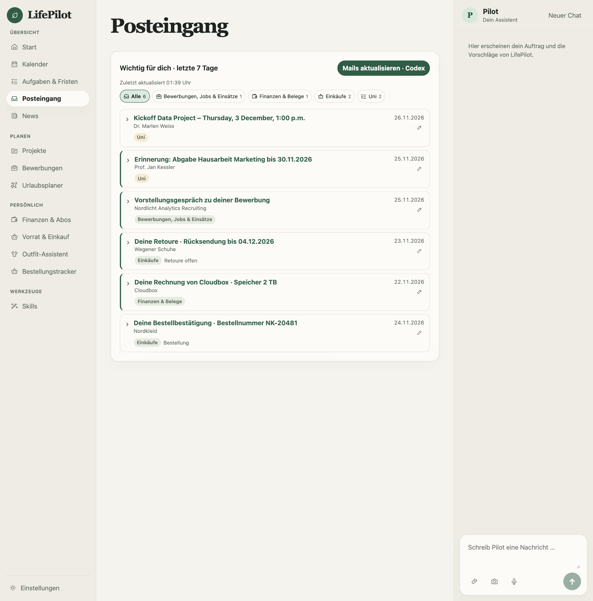
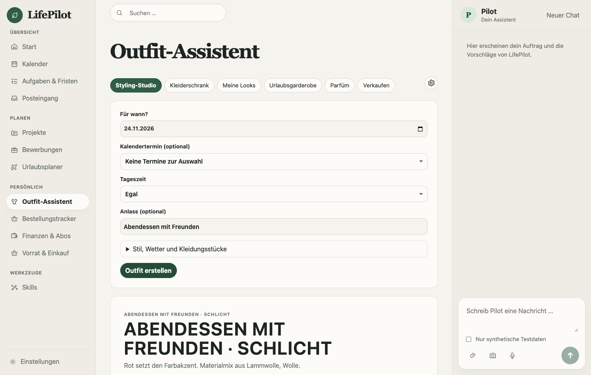
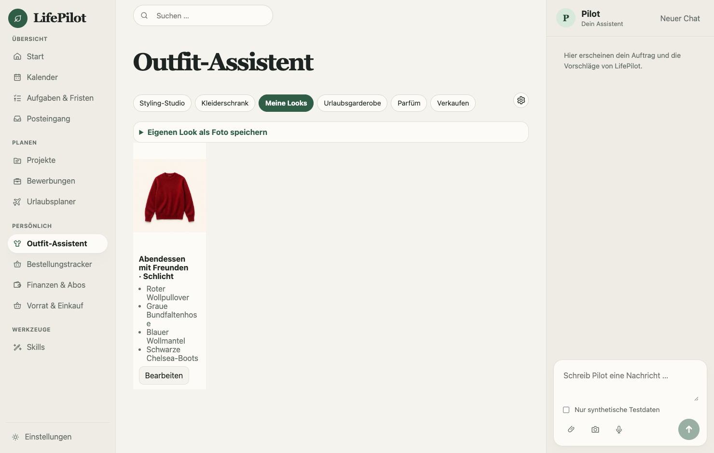
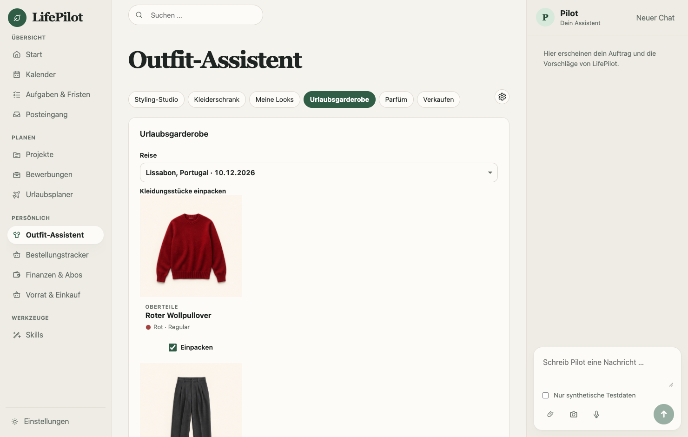
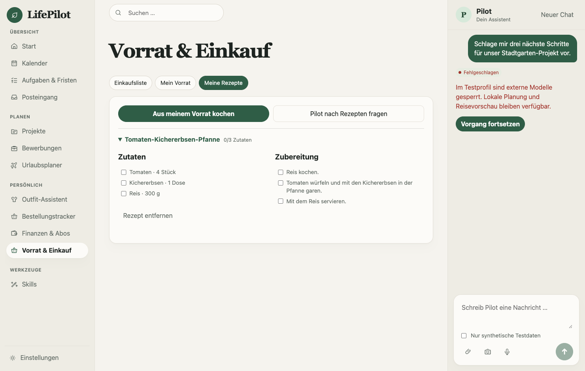
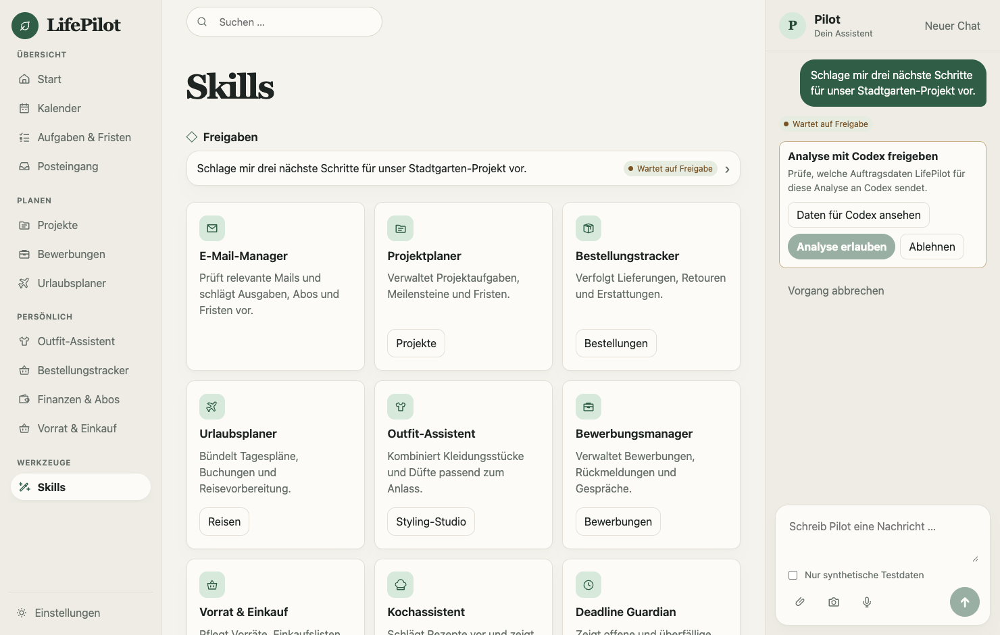

# LifePilot im Testprofil

Die Screenshots stammen aus getrennten Chromium-Sitzungen mit fiktiven Daten. Die ursprünglichen Aufnahmen entstanden mit der Runtime 0.25.16. Pilot, Kleiderschrank, Duftsammlung und die ergänzenden Ansichten wurden mit LifePilot 1.0 aufgenommen. Die Kleidungs- und Flakonbilder sind generierte Beispielmotive. In den neuen Sitzungen war kein Google-Konto verbunden. Die Agentenaufnahme zeigt den lokalen Testmodus.

## Startseite

Wochenbriefing mit Aufgaben, Fristen, nächsten Terminen und wichtigen Mails.

## Pilot-Chat

Pilot nimmt Aufträge im Chat entgegen. Du kannst einen Entwurf prüfen und eine vorgeschlagene Änderung separat bestätigen.

## Kalender

Termine und Serien in der Wochen- oder Monatsansicht planen und freie Zeitfenster finden.

## Aufgaben & Fristen

Aufgaben nach Uni, Privat und Arbeit organisieren und bei Bedarf einem Projekt zuordnen.

## Projekte

Phasen, Checkpoints, verknüpfte Fristen und Fortschritt auf einer Projektkarte sehen.

## Urlaubsplaner

Reisezeitraum und Ziel auswählen, Interessen und Ausschlüsse festlegen und eine Vorschau vorbereiten.

## Posteingang

Wichtige Nachrichten priorisieren und daraus Vorschläge für passende Folgeaktionen ableiten.

## Bestellungstracker

Lieferstatus verfolgen und je Artikel entscheiden, was behalten oder retourniert wird.

## Finanzen & Abos

Einnahmen, Ausgaben und Abo-Vorschläge im Monatsverlauf prüfen.

## Bewerbungen

Bewerbungen nach Status organisieren und nächste Schritte und Gespräche planen.

## Kleiderschrank

Kleidung mit Produktbildern, Kategorien, Farben und Passformen verwalten.

## Parfüm & Düfte

Düfte mit Flakonbild, Duftnoten, Größe und passenden Anlässen sammeln.

## Styling-Studio

Ein Outfit nach Anlass, Tageszeit und vorhandenen Kleidungsstücken zusammenstellen.

## Einkaufsliste

Lebensmittel auf einer nach Warengruppen gegliederten Liste abhaken.

## Meine Looks

Kombinationen und eigene Outfit-Fotos als Looks zusammenhalten.

## Urlaubsgarderobe

Kleidungsstücke aus dem Schrank für eine konkrete Reise auswählen und als Packauswahl speichern.

## Verkaufen

Für ein Kleidungsstück einen Verkaufsentwurf mit Zustand, Preisrahmen und Inseratstext erstellen.

## Mein Vorrat

Vorräte nach Kategorien durchsuchen und den Bestand pflegen.

## Meine Rezepte

Aus vorhandenen Zutaten kochen oder bei Pilot nach Rezeptideen fragen.

## Skills

Verfügbare Fähigkeiten und ihre Verknüpfungen mit den Modulen einsehen.

## Einstellungen & Profil

Profil für persönliche Angaben, Studium und Beruf sowie optionale Verbindungen verwalten.

