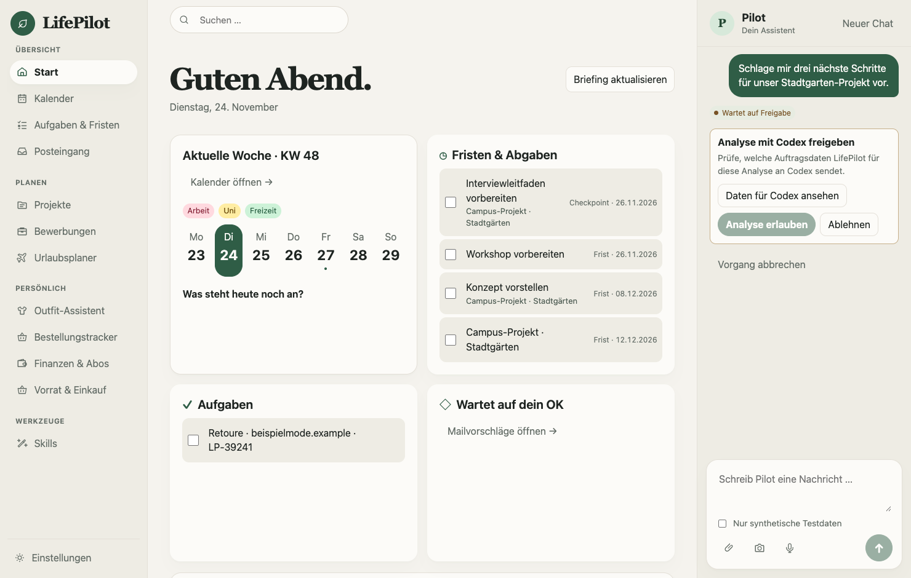
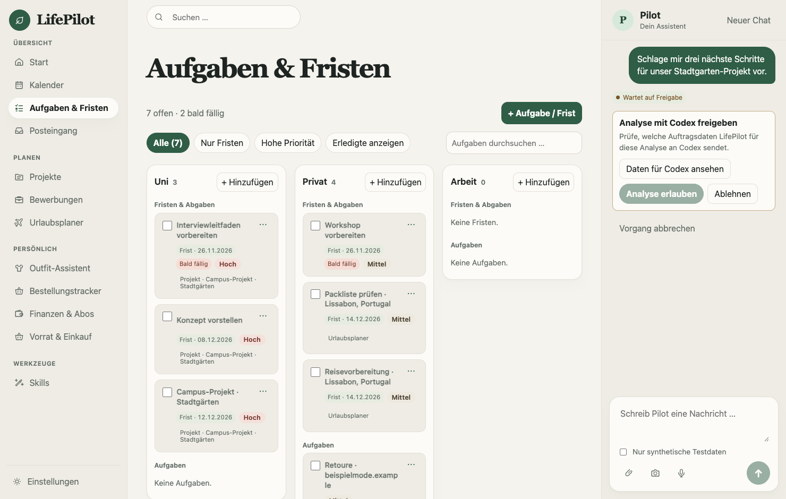
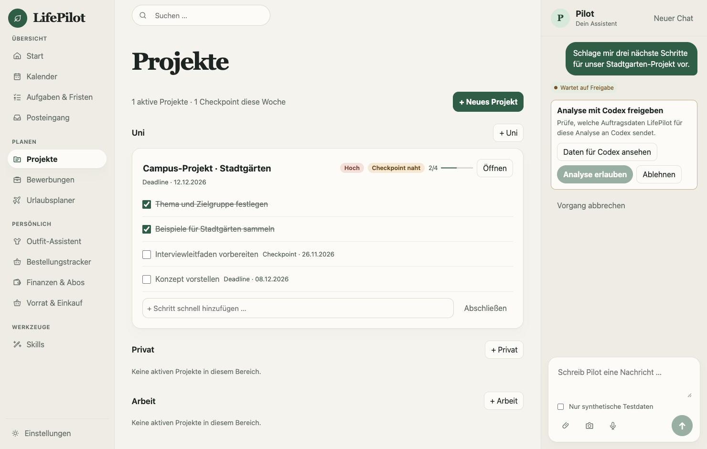
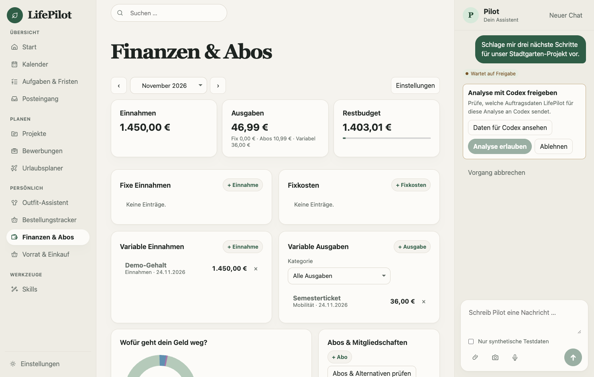
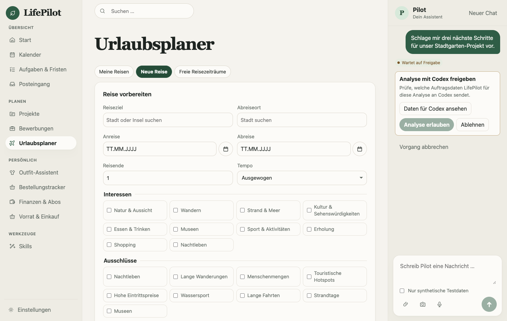
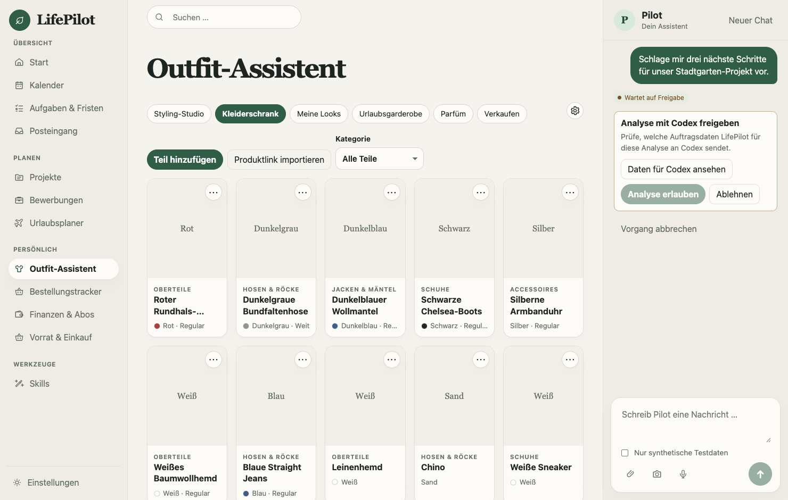
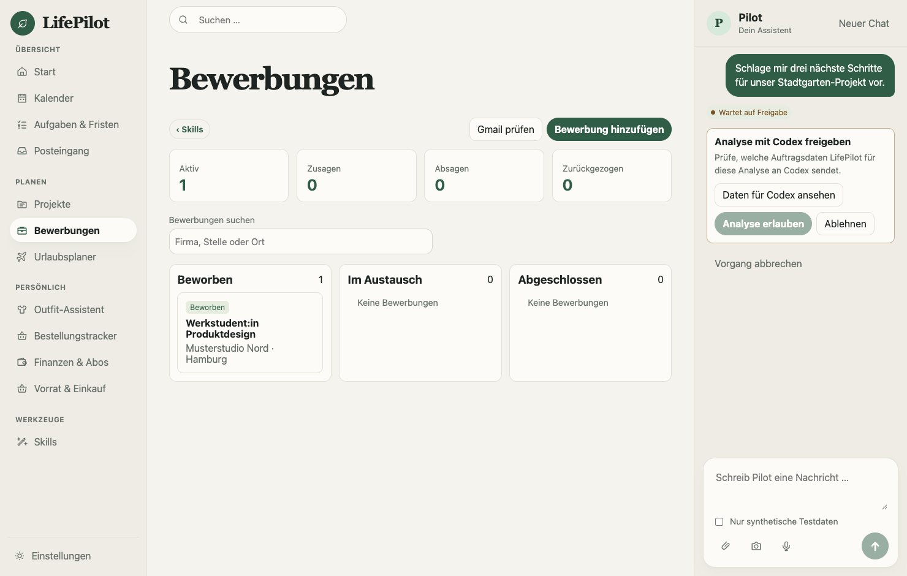
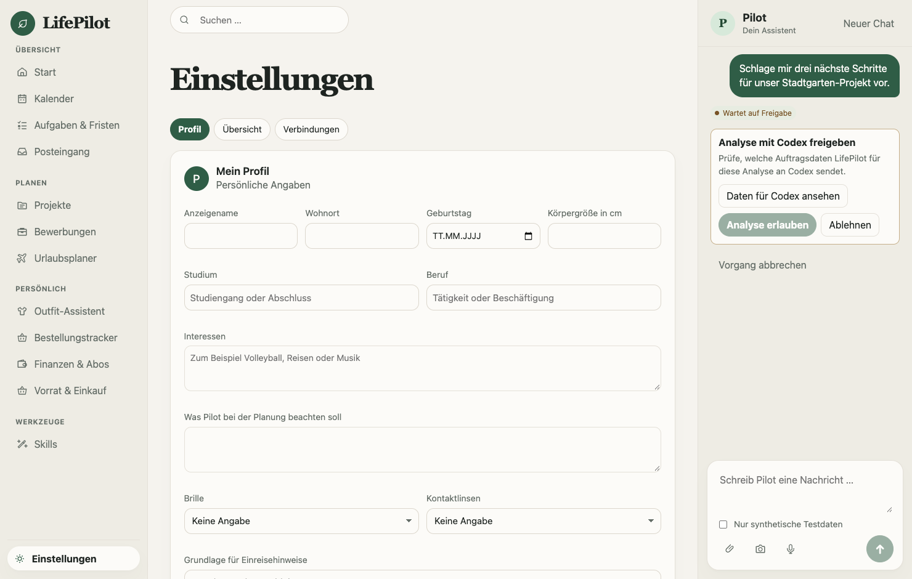

# LifePilot im Testprofil

Die 13 Screenshots zeigen die laufende App aus dem Quellstand der Runtime 0.25.16 bei 1480 × 940 Pixeln. Sie entstanden in einer separaten Testinstanz mit frischer SQLite-Datenbank und einem temporären Chromium-Profil. Projekte, Belege und Nachrichten sind fiktiv. Die Pilot-Anfrage ist als synthetischer Entwurf zu sehen. Für diese Aufnahmen wurde kein Google-Konto verbunden und kein Modell gestartet.

## Start und Pilot

## Kalender

## Aufgaben und Fristen

## Projekte

## Posteingang

## Bestellungstracker

## Finanzen und Abos

## Urlaubsplaner

## Kleiderschrank

## Vorrat und Einkauf

## Bewerbungen

## Skills

## Einstellungen

